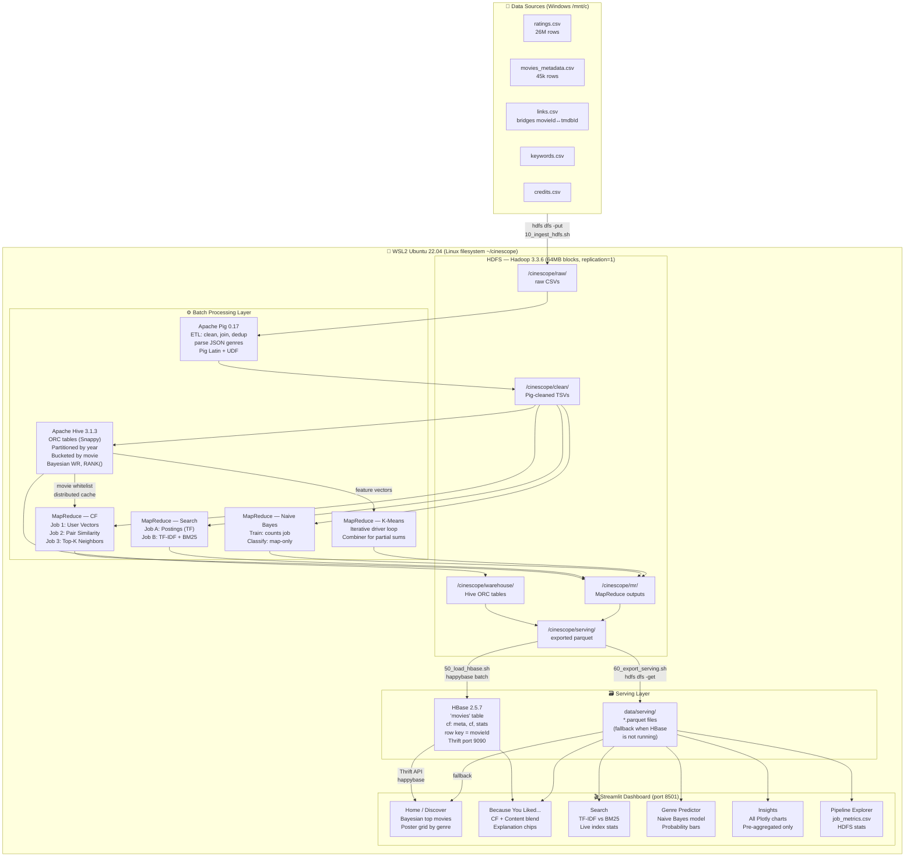

# CineScope — System Architecture

## Mermaid Architecture Diagram



---

## Component Responsibilities

### HDFS (Unit 2)
- **NameNode**: Stores filesystem metadata (file → block mapping). Does NOT store data.
- **DataNode**: Stores actual 64 MB blocks. One DataNode in pseudo-distributed mode.
- **Block size = 64 MB**: ratings.csv (~700 MB) splits into ~11 blocks → ~11 map tasks.
- **Replication = 1**: Single DataNode, so we can't replicate. Real clusters use 3.

### Pig ETL (Unit 4 — Pig)
- Reads malformed CSV (CSVExcelStorage handles embedded newlines/quotes)
- Filters bad rows (non-numeric id), deduplicates, joins with links
- Parses genres (stored as `[{'id': 18, 'name': 'Drama'}, ...]`) via Jython UDF
- Output: clean tab-delimited files in `/cinescope/clean/`

### Hive Warehouse (Unit 4 — Hive)
- External tables over cleaned HDFS data (no data copy)
- Managed ORC tables with Snappy compression for analytics
- Ratings partitioned by `rating_year` (partition pruning skips irrelevant years)
- Ratings bucketed by `movie_id` (sort-merge join without full shuffle)
- Computes: avg rating, Bayesian WR, genre stats, temporal analysis, choropleth data

### MapReduce Jobs (Unit 3 + Unit 6)
- **CF 3-job chain**: User vectors → pair similarities → top-K neighbors
- **Search 2-job chain**: Postings (TF) → TF-IDF/BM25 weights
- **Naive Bayes**: Training count job + map-only classification job
- **K-Means**: Iterative jobs with combiner (partial sum optimization)

### HBase Serving (Unit 4 — HBase)
- Pre-loaded with movie metadata + CF neighbors + cluster labels
- Row key = zero-padded movieId (enables efficient prefix scans)
- Dashboard reads via Thrift; falls back to parquet files if HBase is down

### Streamlit Dashboard (Unit 5 — Visualization)
- ALL charts built from pre-aggregated Hive/MR outputs (never scans raw data)
- Poster URLs: `https://image.tmdb.org/t/p/w342{poster_path}`
- Session state tracks liked movies (no user login required)

---

## Data Flow: A Rating Arrives

```
User rates a movie (in production)
  → Flume agent captures event
  → Written to HDFS /cinescope/raw/ratings/ as Avro
  → Nightly Pig job cleans and deduplicates
  → Hive recomputes Bayesian WR and stats
  → MapReduce CF job updates similarity scores
  → Results loaded into HBase
  → Dashboard serves updated recommendations next morning
```

(In our batch project, steps 1-2 are replaced by `hdfs dfs -put ratings.csv`)

---

## Key Design Decisions

| Decision | Choice | Reason |
|----------|--------|--------|
| Execution engine | MapReduce (not Tez/Spark) | Syllabus requirement; demonstrates MR concepts |
| Metastore | Derby embedded | Zero-config for single-user dev |
| HBase mode | Standalone | Minimal JVMs; sufficient for serving |
| Block size | 64 MB (not 128) | More visible block splits for demonstration |
| Replication | 1 | Single DataNode constraint |
| CF algorithm | Item-based (not user-based) | Scales better: movie catalog < user count |
| Search | TF-IDF + BM25 | Demonstrates both models; enables comparison |
| Pig → Hadoop 3 | Custom pig-env.sh | Classpath fix for moved MR jars |
| Hive → Hadoop 3 | Replace Guava 14 with 27 | Known Hive 3 / Hadoop 3 dependency clash |
